# DevOps Capstone: File Transfer Client

A Python client that connects to the server, receives a file, saves it to `/clientdata` and checks its SHA-256 checksum. It runs in Docker, is deployed to AWS EC2 with Terraform, is monitored with Grafana, and is deployed automatically with GitHub Actions.

## Project Structure

```
devops-capstone-client/
├── app.py               # Client application (Python + Streamlit)
├── Dockerfile           # Client image
├── docker-compose.yml   # Runs the client container
├── requirements.txt     # Python dependencies
├── terraform/           # Part 2: client EC2 instance
├── monitoring/          # Part 3: Grafana, Prometheus, Node Exporter, cAdvisor
├── .github/workflows/   # Part 4: CI/CD pipeline
├── ci/                  # Part 4: deploy and runner scripts
└── images/              # Screenshots
```

## Part 1: Client Container

The client connects to the server on port `5000`, receives a file with its checksum, saves it to `/clientdata` and checks that the SHA-256 checksums match.

### Dockerfile

```dockerfile
FROM python:3.12-slim

ENV PYTHONUNBUFFERED=1

WORKDIR /app

COPY requirements.txt .
RUN pip install --no-cache-dir -r requirements.txt

COPY app.py .

RUN mkdir -p /clientdata
VOLUME ["/clientdata"]

EXPOSE 8501

CMD ["streamlit", "run", "app.py", "--server.port=8501", "--server.address=0.0.0.0", "--browser.gatherUsageStats=false"]
```

### Docker Compose

```yaml
services:
  client:
    build: .
    image: ${DOCKERHUB_USERNAME:-local}/devops-capstone-client:${IMAGE_TAG:-latest}
    container_name: client
    ports:
      - "8501:8501"
    environment:
      - SERVER_HOST=${SERVER_HOST:-server}
      - SERVER_PORT=${SERVER_PORT:-5000}
    volumes:
      - clientvol:/clientdata
    networks:
      - filenet
    restart: unless-stopped

volumes:
  clientvol:
    name: clientvol

networks:
  filenet:
    external: true
```

### Run Locally

```bash
docker network create filenet
docker compose up -d --build
```

Open `http://localhost:8501` and click **Fetch file from server**.

### Screenshots

**Build and start the client:** the image is built and the `clientvol` volume and `client` container are created.

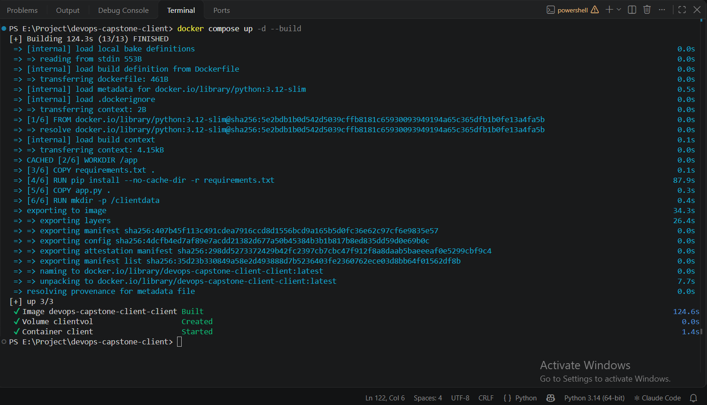

**Client web interface:** set the server host and port, and see the files saved in `/clientdata`.


**File received:** the file is saved and the checksums match.

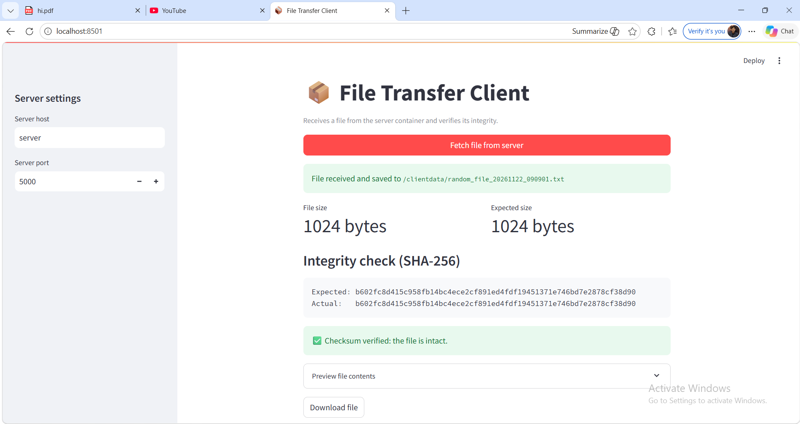

**Docker volumes:** `clientvol` for the client and `servervol` for the server.


## Part 2: Creating VMs, Infra as a Code (IaC)

- **2a.** Two EC2 instances: `saa-server` for the server and `saa-client` for the client.
- **2b.** Both instances are in the same VPC and subnet. The shared security group `saa-sg` allows all traffic inside the VPC, so the client reaches the server on its private IP.
- **2c.** The client's Terraform scripts are in [terraform/](terraform/).

> **Note:** The task asks for `t2.micro`, but this AWS account rejects it as "not eligible for Free Tier". `t3.micro` is the free tier type on newer accounts, so it is used instead.

### Terraform Files

| File | Purpose |
|---|---|
| `providers.tf` | AWS provider and region (`ap-southeast-2`) |
| `variables.tf` / `terraform.tfvars` | Settings such as key pair, instance type and server port |
| `main.tf` | Finds the server's VPC, subnet and server instance, then creates the client EC2 and its security group |
| `outputs.tf` | Client IPs, server private IP, client URL and Grafana URL |
| `user_data.sh.tftpl` | Startup script: installs Docker, starts the client and the monitoring stack |

### Run Terraform

Apply the server's Terraform first, because the client uses the server's network.

```bash
cd terraform
terraform init
terraform validate
terraform plan
terraform apply
```

To delete everything later, run `terraform destroy` (client first, then server).

### Screenshots

**Create the client instance:** name it `saa-client` and choose the Ubuntu image.


**Instance type and key pair:** `t3.micro` with the `saa-key` key pair.


**Network settings:** `saa-vpc`, the public subnet and the `saa-sg` security group.

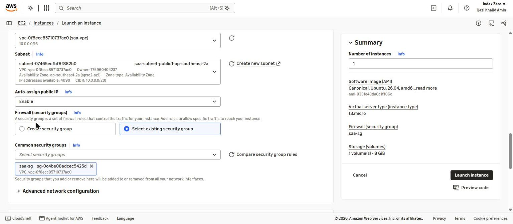

**Instance launched.**


**Both instances running.**

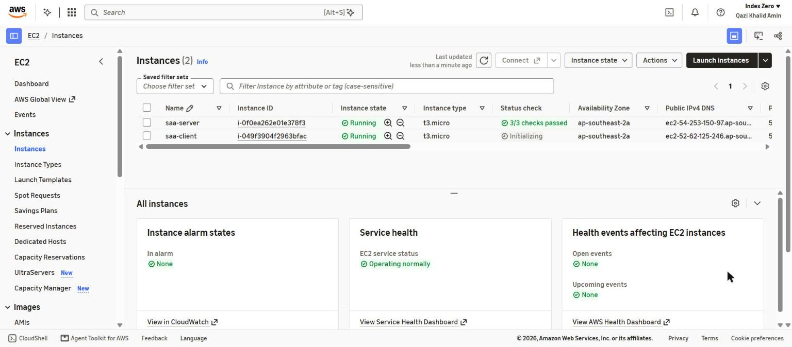

**terraform init:** installs the AWS provider.


**terraform validate:** the configuration is valid.

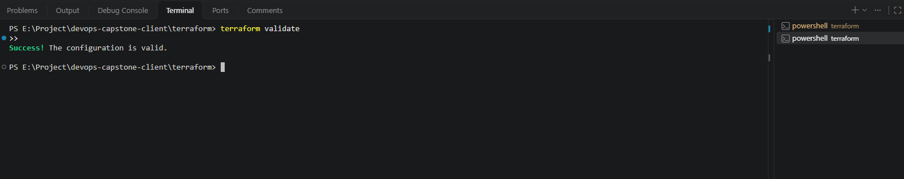

**terraform plan:** finds the server (`10.0.10.13`) and plans 2 new resources.


**terraform apply:** creates the client instance and prints its IPs and URL.


**Verification:** `saa-server` and `saa-client` are both running in `ap-southeast-2a`.


**Client and server talking on EC2:** the client fetches a file from the server's private IP (`10.0.10.13:5000`) and the checksums match.

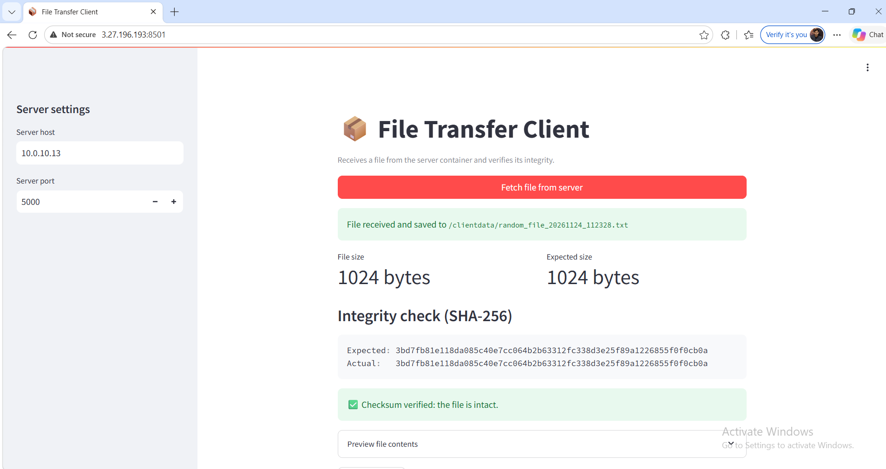

## Part 3: Setting up Monitoring Stack

- A monitoring stack runs on the client VM from [monitoring/](monitoring/).
- Grafana is open on port **3020** over the internet.
- Two dashboards show host system metrics and Docker container metrics.

| Service | Purpose |
|---|---|
| Grafana | Dashboards on port `3020` |
| Prometheus | Collects metrics every 15 seconds |
| Node Exporter | Host metrics: CPU, memory, disk, network |
| cAdvisor | Docker container metrics |

### Dashboards

- **Host System Metrics:** uptime, CPU, memory, disk, network, system load and disk I/O.
- **Docker Container Metrics:** running containers, plus CPU, memory and network for each container.

### Run It

Terraform starts the monitoring stack automatically on the VM. To run it by hand:

```bash
cd monitoring
GRAFANA_ADMIN_PASSWORD='your-password' docker compose up -d
```

Open `http://<client-public-ip>:3020` and log in as `admin`.

> **Docker 29 fix:** cAdvisor did not work with Docker 29 at first. The startup script fixes this by allowing Docker API 1.41 and turning off the containerd image store.

### Screenshots

**terraform apply:** the client VM is recreated with port 3020 open, and `grafana_url` is printed.

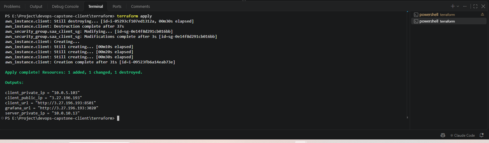

**Grafana login** on port 3020.

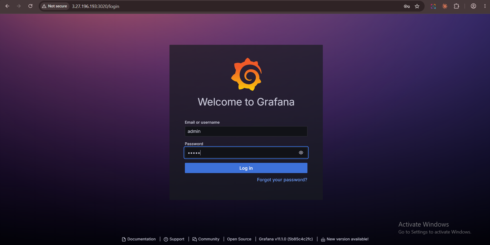

**Host System Metrics dashboard** with live data.

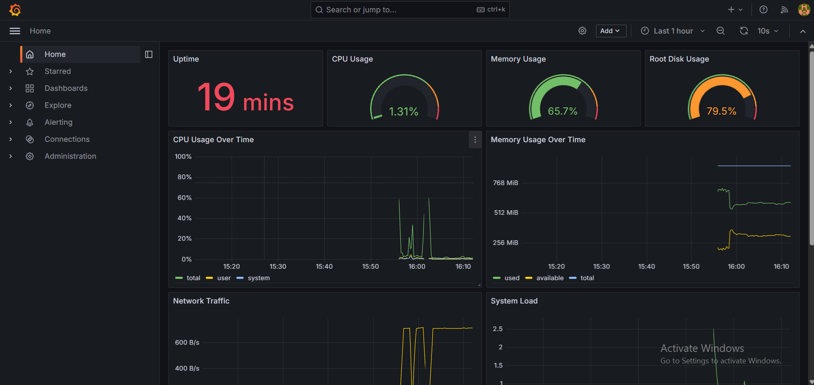

## Part 4: Setting up CI/CD Pipelines

- The client and server have separate GitHub repositories.
- Every push to `main` builds the image and pushes it to Docker Hub.
- The client VM is a private GitHub runner, which updates the image tag in Docker Compose, pulls the new image and deploys it.
- A Slack message is sent after each deployment.

### Pipeline

```
push to main → build and push to Docker Hub → deploy on client VM → Slack message
```

| Job | Runs on | What it does |
|---|---|---|
| build | GitHub (`ubuntu-latest`) | Builds the image and pushes `sha-<commit>` and `latest` tags |
| deploy | Client VM (`saa_client` runner) | Runs `ci/deploy.sh`: updates the tag, pulls, restarts and checks health |
| notify | GitHub (`ubuntu-latest`) | Sends the result to Slack |

### Setup

Add these in **Settings > Secrets and variables > Actions**:

| Type | Name |
|---|---|
| Variable | `DOCKERHUB_USERNAME` |
| Secret | `DOCKERHUB_TOKEN` |
| Secret | `SLACK_WEBHOOK_URL` |

### Private Runner on the Client VM

**Step 1:** Open **Settings > Actions > Runners**. There are no runners yet.

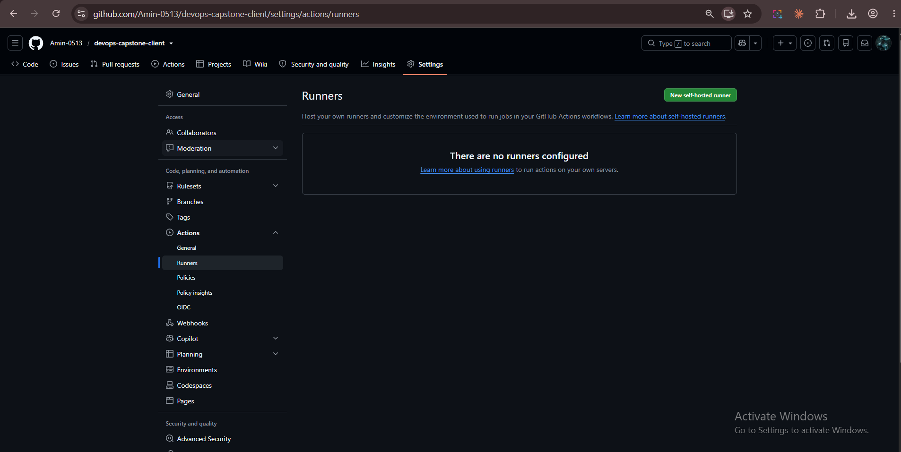

**Step 2:** Click **New self-hosted runner**, choose **Linux** and **x64**, and copy the commands. The token is hidden here because it is secret.

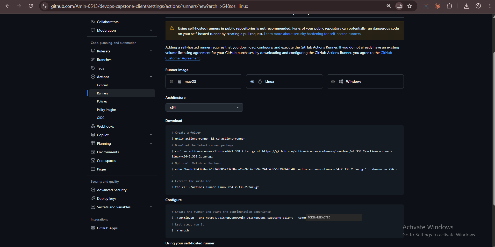

**Step 3:** Run the commands on the client VM. The runner is named `saa_client` with the label `saa_client`.

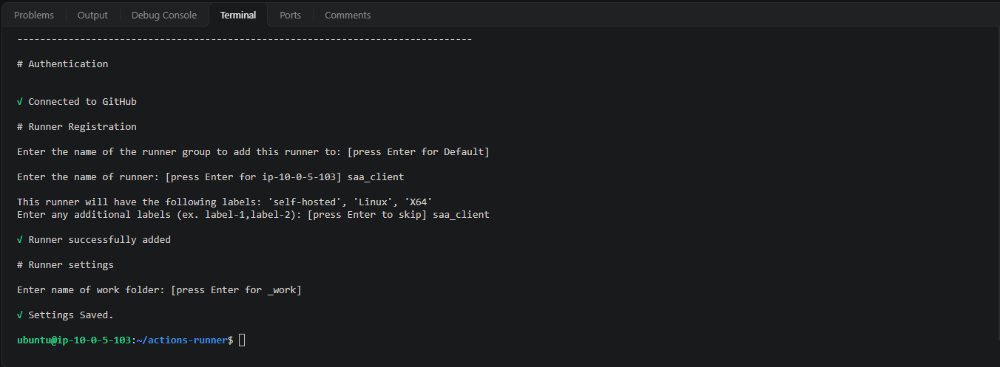

Then install it as a service:

```bash
sudo ./svc.sh install ubuntu
sudo ./svc.sh start
sudo usermod -aG docker ubuntu
```

**Step 4:** The runner `saa_client` is online and **Idle**.

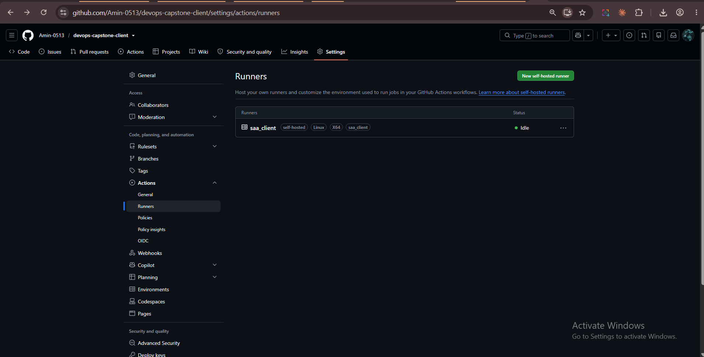

### Deploy

Push a commit to `main`, or go to **Actions > CI/CD - client > Run workflow**.
