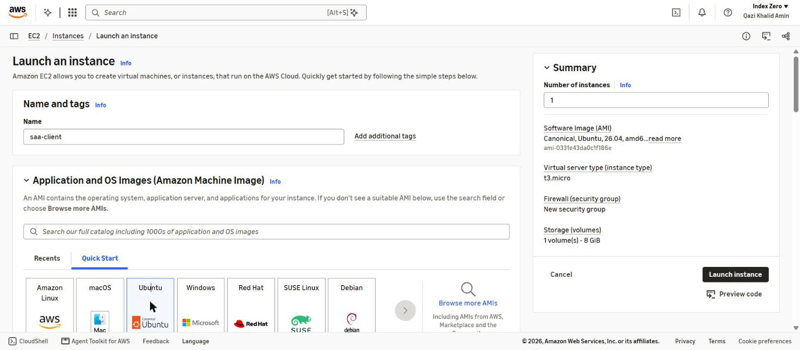
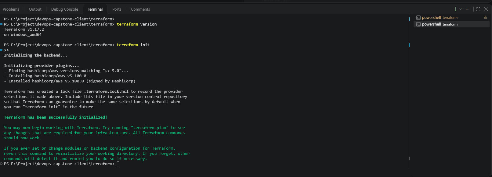
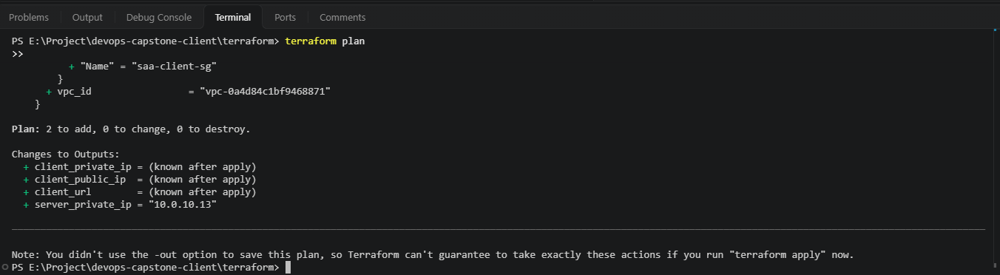
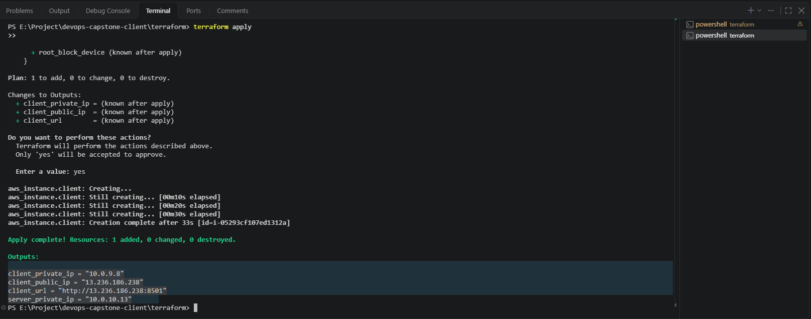

# DevOps Capstone: File Transfer Client

This is the client side of the capstone project. It runs in a Docker container, connects to the server container, receives a file, saves it to the `/clientdata` directory and checks that the file was not changed in transit by comparing SHA-256 checksums.

The client has a web interface built with Streamlit, available at `http://localhost:8501`.

## Features

- Connects to the server over TCP (`server:5000` by default)
- Receives the file together with a JSON header holding the file name, size and checksum
- Saves each received file to `/clientdata` with a timestamp, so earlier files are kept
- Calculates the SHA-256 checksum of the received file and compares it with the server's checksum
- Lists every file stored in the `clientvol` volume

## Project Structure

```
devops-capstone-client/
├── app.py               # Client application (Python + Streamlit)
├── Dockerfile           # Builds the client image
├── docker-compose.yml   # Defines and runs the client container
├── requirements.txt     # Python dependencies
├── terraform/           # Terraform scripts for the client EC2 instance
├── monitoring/          # Prometheus, Node Exporter, cAdvisor and Grafana
├── images/              # Screenshots
└── README.md
```

## Dockerfile

The image is based on the official `python:3.12-slim` image. It installs the dependencies, copies in the application and declares `/clientdata` as a volume.

```dockerfile
FROM python:3.12-slim

ENV PYTHONUNBUFFERED=1

WORKDIR /app

# Install dependencies
COPY requirements.txt .
RUN pip install --no-cache-dir -r requirements.txt

COPY app.py .

# Volume mount point
RUN mkdir -p /clientdata
VOLUME ["/clientdata"]

# Streamlit default port
EXPOSE 8501

CMD ["streamlit", "run", "app.py", "--server.port=8501", "--server.address=0.0.0.0", "--browser.gatherUsageStats=false"]
```

## Docker Compose

The Compose file builds the client, mounts the named volume `clientvol` at `/clientdata` and connects the container to the shared `filenet` network so it can reach the server.

```yaml
services:
  client:
    build: .
    container_name: client
    ports:
      - "8501:8501"
    environment:
      - SERVER_HOST=${SERVER_HOST:-server}
      - SERVER_PORT=${SERVER_PORT:-5000}
    volumes:
      - clientvol:/clientdata
    networks:
      - filenet
    restart: unless-stopped

volumes:
  clientvol:
    name: clientvol

networks:
  filenet:
    external: true
```

## Requirements

```
streamlit==1.39.0
```

## How the Transfer Works

1. The client opens a TCP connection to the server.
2. The server sends one line of JSON followed by the file bytes:
   ```json
   {"filename": "file.txt", "size": 1024, "checksum": "<sha256-hex>"}
   ```
3. The client reads bytes until it has received `size` bytes.
4. The file is saved to `/clientdata/<name>_<timestamp><ext>`.
5. The client calculates the SHA-256 of the received bytes and compares it with `checksum`. It shows a success message if they match and an error if they do not.

## How to Run

### 1. Create the shared network (only if it does not exist yet)

```bash
docker network create filenet
```

### 2. Start the server container

Start the server project first, so that a container named `server` is listening on port 5000 on the `filenet` network.

### 3. Build and start the client

```bash
docker compose up -d --build
```

### 4. Open the client

Go to `http://localhost:8501` and click **Fetch file from server**.

### 5. Check the volume

```bash
docker exec client ls -l /clientdata
docker volume inspect clientvol
```

### 6. Stop the client

```bash
docker compose down
```

## Environment Variables

| Variable      | Default  | Description                  |
|---------------|----------|------------------------------|
| `SERVER_HOST` | `server` | Host name of the server      |
| `SERVER_PORT` | `5000`   | Port the server listens on   |

## Screenshots

### 1. Building and starting the client

Running `docker compose up -d --build` builds the image from `python:3.12-slim`, installs the dependencies, creates the `clientvol` volume and starts the `client` container.


### 2. Client web interface

The Streamlit interface at `localhost:8501`. The sidebar sets the server host (`server`) and port (`5000`). The table lists the files already saved in `/clientdata`.


### 3. File received and checksum verified

After you click **Fetch file from server**, the client receives a 1024-byte file and saves it to `/clientdata`. The expected and actual SHA-256 checksums match, which confirms the file is intact.


### 4. Docker volumes

`docker volume ls` shows the `clientvol` volume used by the client, alongside the server's `servervol` volume.


## Part 2: Creating VMs, Infra as a Code (IaC)

This part has 3 sub parts:

- **2a.** Create two AWS EC2 instances (VMs), one for hosting the server container and another for hosting the client container.
- **2b.** Configure the VPC and subnets appropriately to allow communication between the two EC2 instances. Use the t2.micro instance type, which is covered in the AWS free tier.
- **2c.** Use Terraform for infrastructure automation. Place your Terraform scripts in the "terraform" directory of your client and server GitHub repositories.

### 2a. Create Two EC2 Instances

Two EC2 instances are created in the `ap-southeast-2` (Sydney) region:

| Name         | Purpose                         | AMI                 | Instance type |
|--------------|---------------------------------|---------------------|---------------|
| `saa-server` | Hosts the server container      | Ubuntu 22.04 (x86)  | `t3.micro`    |
| `saa-client` | Hosts the client container      | Ubuntu 22.04 (x86)  | `t3.micro`    |

> **Note:** The task asks for `t2.micro`, but this AWS account rejects it with *"The specified instance type is not eligible for Free Tier"*. On newer AWS accounts, `t3.micro` is the free tier instance type, so `t3.micro` is used instead.

The server instance is created by the Terraform scripts in the server repository, and the client instance by the Terraform scripts in this repository (see 2c). The screenshots below show the same setup done manually in the AWS console.

#### Step 1: Name the instance and choose the AMI

In **EC2 > Instances > Launch an instance**, the instance is named `saa-client` and the **Ubuntu** AMI is selected from Quick Start.



#### Step 2: Choose the instance type and key pair

The free tier eligible `t3.micro` instance type is selected (2 vCPU, 1 GiB memory), and the `saa-key` key pair is used for SSH access.


### 2b. Configure the VPC and Subnets

Both instances are placed in the same VPC and subnet, so they can reach each other over private IP addresses.

| Setting          | Value                                                        |
|------------------|--------------------------------------------------------------|
| VPC              | `saa-vpc` (`10.0.0.0/16`)                                    |
| Subnet           | `saa-public-subnet` in `ap-southeast-2a`                     |
| Internet access  | `saa-igw` internet gateway and `saa-public-rt` route table   |
| Auto-assign IP   | Enabled (public IP for SSH and the web interface)            |
| Security group   | `saa-sg`, shared by both instances: SSH, server port, and all traffic inside the VPC |
| Client SG        | `saa-client-sg`: port `8501` for the client web interface    |

The VPC, subnet, internet gateway and `saa-sg` are created by the server repository. Because `saa-sg` allows all traffic from `10.0.0.0/16`, the client reaches the server on its private IP.

#### Step 3: Select the VPC, subnet and security group

The instance is launched into `saa-vpc` and the public subnet in `ap-southeast-2a`, with auto-assign public IP enabled and the existing `saa-sg` security group attached.


#### Step 4: Launch the instance

After clicking **Launch instance**, AWS confirms that the client instance launched successfully.


#### Step 5: Verify both instances are running

The Instances page shows `saa-server` and `saa-client` both in the **Running** state in the same availability zone (`ap-southeast-2a`).


### 2c. Terraform for Infrastructure Automation

The Terraform scripts are in the [terraform](terraform/) directory of this repository. The client scripts reuse the network created by the server repository, look up the server instance, and create the client EC2 instance.

```
terraform/
├── providers.tf          # Terraform settings and AWS provider
├── variables.tf          # Input variables
├── terraform.tfvars      # Values for the variables
├── main.tf               # Looks up the shared network and server, creates the client EC2
├── outputs.tf            # Client IPs, server private IP and client URL
└── user_data.sh.tftpl    # Startup script that installs Docker and runs the client
```

#### providers.tf

```hcl
terraform {
  required_version = ">= 1.3.0"
  required_providers {
    aws = {
      source  = "hashicorp/aws"
      version = "~> 5.0"
    }
  }
}

provider "aws" {
  region = var.region
}
```

#### variables.tf

```hcl
variable "region" {
  description = "AWS region"
  type        = string
  default     = "ap-southeast-2"
}

variable "key_name" {
  description = "Existing EC2 key pair name"
  type        = string
  default     = "saa-key"
}

variable "instance_type" {
  description = "EC2 instance type"
  type        = string
  default     = "t3.micro"
}

variable "ui_cidr" {
  description = "Who may open the client web interface"
  type        = string
  default     = "0.0.0.0/0"
}

variable "server_port" {
  description = "Port the server container listens on"
  type        = number
  default     = 5000
}

variable "vpc_id" {
  description = "VPC ID to use when more than one saa-vpc exists"
  type        = string
  default     = ""
}

variable "server_instance_id" {
  description = "Server instance ID to use when more than one saa-server exists"
  type        = string
  default     = ""
}

variable "grafana_admin_password" {
  description = "Grafana admin password"
  type        = string
  sensitive   = true
}

variable "repo_url" {
  description = "Client GitHub repository"
  type        = string
  default     = "https://github.com/Amin-0513/devops-capstone-client.git"
}
```

#### terraform.tfvars

```hcl
region        = "ap-southeast-2"
key_name      = "saa-key"
instance_type = "t3.micro"
server_port   = 5000
```

#### main.tf

```hcl
data "aws_ami" "ubuntu" {
  most_recent = true
  owners      = ["099720109477"]

  filter {
    name   = "name"
    values = ["ubuntu/images/hvm-ssd/ubuntu-jammy-22.04-amd64-server-*"]
  }
}

data "aws_subnet" "saa_public_subnet" {
  vpc_id = var.vpc_id != "" ? var.vpc_id : null
  tags   = { Name = "saa-public-subnet" }
}

locals {
  vpc_id = data.aws_subnet.saa_public_subnet.vpc_id
}

data "aws_security_group" "saa_sg" {
  vpc_id = local.vpc_id
  name   = "saa-sg"
}

data "aws_instance" "server" {
  instance_id = var.server_instance_id != "" ? var.server_instance_id : null

  dynamic "filter" {
    for_each = var.server_instance_id == "" ? [1] : []
    content {
      name   = "tag:Name"
      values = ["saa-server"]
    }
  }

  filter {
    name   = "vpc-id"
    values = [local.vpc_id]
  }

  filter {
    name   = "instance-state-name"
    values = ["running"]
  }
}

resource "aws_security_group" "saa_client_sg" {
  name        = "saa-client-sg"
  description = "Client web interface"
  vpc_id      = local.vpc_id

  ingress {
    description = "Streamlit"
    from_port   = 8501
    to_port     = 8501
    protocol    = "tcp"
    cidr_blocks = [var.ui_cidr]
  }

  ingress {
    description = "Grafana"
    from_port   = 3020
    to_port     = 3020
    protocol    = "tcp"
    cidr_blocks = [var.ui_cidr]
  }

  egress {
    from_port   = 0
    to_port     = 0
    protocol    = "-1"
    cidr_blocks = ["0.0.0.0/0"]
  }

  tags = { Name = "saa-client-sg" }
}

resource "aws_instance" "client" {
  ami           = data.aws_ami.ubuntu.id
  instance_type = var.instance_type
  subnet_id     = data.aws_subnet.saa_public_subnet.id
  key_name      = var.key_name

  vpc_security_group_ids = [
    data.aws_security_group.saa_sg.id,
    aws_security_group.saa_client_sg.id,
  ]

  user_data = templatefile("${path.module}/user_data.sh.tftpl", {
    server_ip        = data.aws_instance.server.private_ip
    server_port      = var.server_port
    repo_url         = var.repo_url
    grafana_password = var.grafana_admin_password
  })
  user_data_replace_on_change = true

  tags = { Name = "saa-client" }
}
```

#### outputs.tf

```hcl
output "client_public_ip" {
  value = aws_instance.client.public_ip
}

output "client_private_ip" {
  value = aws_instance.client.private_ip
}

output "server_private_ip" {
  description = "Server IP the client container connects to"
  value       = data.aws_instance.server.private_ip
}

output "client_url" {
  value = "http://${aws_instance.client.public_ip}:8501"
}

output "grafana_url" {
  value = "http://${aws_instance.client.public_ip}:3020"
}
```

#### user_data.sh.tftpl

```bash
#!/bin/bash
mkdir -p /etc/docker /etc/systemd/system/docker.service.d
echo '{"features":{"containerd-snapshotter":false}}' > /etc/docker/daemon.json
printf '[Service]\nEnvironment=DOCKER_MIN_API_VERSION=1.41\n' > /etc/systemd/system/docker.service.d/min-api.conf

apt-get update -y
apt-get install -y docker.io docker-compose-v2 git
systemctl enable --now docker
usermod -aG docker ubuntu

echo "SERVER_HOST=${server_ip}" >> /etc/environment
echo "SERVER_PORT=${server_port}" >> /etc/environment

git clone ${repo_url} /opt/client
cd /opt/client
docker network create filenet || true
SERVER_HOST=${server_ip} SERVER_PORT=${server_port} docker compose up -d --build

cd /opt/client/monitoring
GRAFANA_ADMIN_PASSWORD='${grafana_password}' docker compose up -d
```

#### Step 6: Apply the server Terraform first

The client depends on the VPC, subnet, security group and server instance, so run `terraform apply` in the server repository's `terraform` directory first.

#### Step 7: Apply the client Terraform

```bash
cd terraform
terraform init
terraform plan
terraform apply
```

When it finishes, Terraform prints `client_url`. Open it in a browser to use the client.

##### terraform init

`terraform init` (Terraform v1.17.2) downloads the `hashicorp/aws` provider v5.100.0 and initializes the working directory.



##### terraform validate

`terraform validate` confirms that the configuration is valid.


##### terraform plan

`terraform plan` finds the shared VPC created by the server repository and the server's private IP (`10.0.10.13`). It plans **2 to add**: the `saa-client-sg` security group and the `saa-client` EC2 instance.



##### terraform apply

`terraform apply` creates the client EC2 instance in about 33 seconds. The outputs show the client's private IP (`10.0.9.8`), its public IP, the `client_url` on port `8501`, and the server private IP (`10.0.10.13`) that the client container connects to. Both private IPs are in the same VPC, so the client can reach the server.



#### Step 8: Destroy the resources when finished

Destroy the client first, then the server, because the server owns the shared network.

```bash
terraform destroy
```

### Verification

The EC2 Instances page shows both VMs, `saa-server` and `saa-client`, in the **Running** state in the same availability zone (`ap-southeast-2a`). Each instance has its own public IPv4 DNS name, the server has passed all 3 status checks, and the EC2 service status is **Operating normally**.


## Part 3: Setting up Monitoring Stack

This part has 3 sub parts:

- Set up a monitoring stack (e.g., Grafana) on each VM.
- Make the Grafana dashboard accessible at port 3020 of each VM (over the internet, if using EC2 instances).
- Create appropriate dashboards to view host system metrics and Docker container metrics.

### 3a. Monitoring Stack

The monitoring stack runs on the client VM with Docker Compose, from the [monitoring](monitoring/) directory.

| Service         | Image                               | Purpose                                      |
|-----------------|-------------------------------------|----------------------------------------------|
| `prometheus`    | `prom/prometheus:v2.53.0`           | Collects and stores metrics every 15 seconds |
| `node-exporter` | `prom/node-exporter:v1.8.1`         | Host system metrics (CPU, memory, disk, network) |
| `cadvisor`      | `gcr.io/cadvisor/cadvisor:v0.49.1`  | Docker container metrics                     |
| `grafana`       | `grafana/grafana:11.1.0`            | Dashboards, published on port `3020`         |

```
monitoring/
├── docker-compose.yml
├── prometheus/
│   └── prometheus.yml
└── grafana/
    ├── provisioning/
    │   ├── datasources/datasource.yml
    │   └── dashboards/dashboards.yml
    └── dashboards/
        ├── host-metrics.json
        └── docker-metrics.json
```

#### monitoring/docker-compose.yml

```yaml
name: monitoring

services:
  prometheus:
    image: prom/prometheus:v2.53.0
    container_name: prometheus
    command:
      - --config.file=/etc/prometheus/prometheus.yml
      - --storage.tsdb.path=/prometheus
      - --storage.tsdb.retention.time=3d
    volumes:
      - ./prometheus/prometheus.yml:/etc/prometheus/prometheus.yml:ro
      - prometheus_data:/prometheus
    networks:
      - monitoring
    restart: unless-stopped

  node-exporter:
    image: prom/node-exporter:v1.8.1
    container_name: node-exporter
    command:
      - --path.rootfs=/host
    pid: host
    volumes:
      - /:/host:ro,rslave
    networks:
      - monitoring
    restart: unless-stopped

  cadvisor:
    image: gcr.io/cadvisor/cadvisor:v0.49.1
    container_name: cadvisor
    privileged: true
    devices:
      - /dev/kmsg
    volumes:
      - /:/rootfs:ro
      - /var/run:/var/run:ro
      - /sys:/sys:ro
      - /var/lib/docker/:/var/lib/docker:ro
      - /dev/disk/:/dev/disk:ro
    networks:
      - monitoring
    restart: unless-stopped

  grafana:
    image: grafana/grafana:11.1.0
    container_name: grafana
    ports:
      - "3020:3000"
    environment:
      - GF_SECURITY_ADMIN_USER=admin
      - GF_SECURITY_ADMIN_PASSWORD=${GRAFANA_ADMIN_PASSWORD:-admin}
      - GF_USERS_ALLOW_SIGN_UP=false
      - GF_DASHBOARDS_DEFAULT_HOME_DASHBOARD_PATH=/var/lib/grafana/dashboards/host-metrics.json
    volumes:
      - ./grafana/provisioning:/etc/grafana/provisioning:ro
      - ./grafana/dashboards:/var/lib/grafana/dashboards:ro
      - grafana_data:/var/lib/grafana
    depends_on:
      - prometheus
    networks:
      - monitoring
    restart: unless-stopped

volumes:
  prometheus_data:
  grafana_data:

networks:
  monitoring:
```

#### monitoring/prometheus/prometheus.yml

```yaml
global:
  scrape_interval: 15s
  evaluation_interval: 15s

scrape_configs:
  - job_name: prometheus
    static_configs:
      - targets: ["prometheus:9090"]

  - job_name: node-exporter
    static_configs:
      - targets: ["node-exporter:9100"]
        labels:
          host: client-vm

  - job_name: cadvisor
    static_configs:
      - targets: ["cadvisor:8080"]
        labels:
          host: client-vm
```

#### Grafana provisioning

Grafana is configured automatically when it starts: Prometheus is added as the default data source, and both dashboards are loaded into a **Monitoring** folder.

```yaml
apiVersion: 1

datasources:
  - name: Prometheus
    uid: prometheus
    type: prometheus
    access: proxy
    url: http://prometheus:9090
    isDefault: true
    editable: false
```

### 3b. Grafana on Port 3020

Grafana listens on port `3000` inside the container, which is published as port `3020` on the VM. The client security group `saa-client-sg` in Terraform allows port `3020` from the internet:

```hcl
  ingress {
    description = "Grafana"
    from_port   = 3020
    to_port     = 3020
    protocol    = "tcp"
    cidr_blocks = [var.ui_cidr]
  }
```

The Terraform startup script starts the monitoring stack automatically when the VM boots:

```bash
cd /opt/client/monitoring
GRAFANA_ADMIN_PASSWORD='${grafana_password}' docker compose up -d
```

The Grafana admin password is a sensitive Terraform variable (`grafana_admin_password`), so it is never stored in GitHub. Terraform asks for it when you run `terraform apply`.

After `terraform apply`, Terraform prints `grafana_url`:

```
http://<client-public-ip>:3020
```

Log in with user `admin` and the password you entered.

### 3c. Dashboards

#### Host System Metrics

Uses Node Exporter metrics to show the health of the VM:

| Panel                  | Metric                                                     |
|------------------------|------------------------------------------------------------|
| Uptime                 | Time since the VM booted                                   |
| CPU Usage              | Gauge and graph of total, user and system CPU              |
| Memory Usage           | Gauge and graph of used, available and total memory        |
| Root Disk Usage        | Percentage of the `/` filesystem in use                    |
| Network Traffic        | Bytes received and transmitted per second                  |
| System Load            | 1, 5 and 15 minute load averages                           |
| Disk I/O               | Bytes read and written per second                          |

#### Docker Container Metrics

Uses cAdvisor metrics to show every running container (`client`, `grafana`, `prometheus`, `node-exporter`, `cadvisor`):

| Panel                              | Metric                                          |
|------------------------------------|-------------------------------------------------|
| Running Containers                 | Number of running containers                    |
| Total Container CPU / Memory       | CPU and memory used by all containers together  |
| CPU Usage per Container            | CPU percentage of each container                |
| Memory Usage per Container         | Memory used by each container                   |
| Network Received / Transmitted     | Network traffic of each container               |
| Containers                         | Table of each container with its image, CPU and memory |

### Deploying the Monitoring Stack

`user_data_replace_on_change = true` is set on the client instance, so changing the startup script makes Terraform replace the VM. The new VM installs Docker, starts the client and starts the monitoring stack.

```bash
cd terraform
terraform apply
```

Wait 3 to 5 minutes for the VM to finish setting up, then open `grafana_url`.

#### Docker 29 compatibility fix

Ubuntu installs Docker 29, which breaks cAdvisor v0.49.1 in two ways, so the Docker dashboard showed **No data**:

1. Docker 29 only accepts API version 1.44 or newer, but cAdvisor uses 1.41: *"client version 1.41 is too old"*.
2. Docker 29 uses the containerd image store by default, and cAdvisor cannot find container layers in it: *"failed to identify the read-write layer ID"*.

The startup script fixes both before Docker is installed, by allowing API 1.41 and switching Docker back to the classic `overlay2` storage:

```bash
echo '{"features":{"containerd-snapshotter":false}}' > /etc/docker/daemon.json
printf '[Service]\nEnvironment=DOCKER_MIN_API_VERSION=1.41\n' > /etc/systemd/system/docker.service.d/min-api.conf
```

To run the monitoring stack on a machine by hand:

```bash
cd monitoring
GRAFANA_ADMIN_PASSWORD='your-password' docker compose up -d
```

### Part 3 Verification

#### Step 1: Deploy with Terraform

`terraform apply` replaces the client VM because the startup script changed. It also updates `saa-client-sg` to open port `3020`. The outputs now include `grafana_url`.


#### Step 2: Grafana login on port 3020

The Grafana login page opens over the internet at `http://<client-public-ip>:3020`. Log in with user `admin` and the password set during `terraform apply`.


#### Step 3: Host System Metrics dashboard

After login, the **Host System Metrics** dashboard opens as the home page. It shows live data from Node Exporter: uptime, CPU, memory and root disk usage gauges, plus graphs of CPU, memory, network traffic and system load. It refreshes every 10 seconds.


